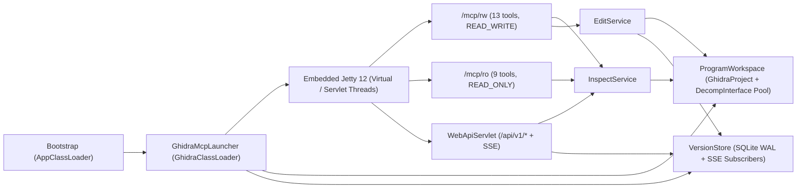

# ghidraMCP internals and architecture

`ghidraMCP` is a standalone headless Java application that embeds Ghidra 12.2, Jetty 12, SQLite, and the MCP Java SDK 2.1.0 inside one JVM. It runs without Swing, AWT windows, or `Xvfb`.

## Component architecture

| Class | Role |
|---|---|
| `Bootstrap` | Minimal entry point loaded on `AppClassLoader` alongside Ghidra `Utility.jar`. |
| `GhidraMcpLauncher` | Implements `GhidraLaunchable`; parses flags, boots Jetty and Ghidra, writes `ready.json`, and coordinates shutdown. |
| `ProgramWorkspace` | Owns the single `GhidraProject` and `Program`, SHA-256 project cache, `ReentrantReadWriteLock`, `DecompInterface` pool, and decompile cache. |
| `InspectService` | Implements the 9 read-only MCP queries and live inspection REST handlers under read lock. |
| `EditService` | Enforces `AccessMode.READ_WRITE`, checks `expected_version`, runs single-transaction edits, computes diffs, and applies multi-step reverts under write lock. |
| `VersionStore` | SQLite WAL ledger storing `v0` metadata, ordered mutation versions, inverse operations, function diffs, checkpoints, and SSE event listeners. |
| `McpEndpoints` | Registers `/mcp/rw` and `/mcp/ro` `HttpServletStreamableServerTransportProvider` instances with `ToolAnnotations` and Host/Origin checks. |
| `WebApiServlet` | Serves `/api/v1/*` JSON endpoints, async SSE `/api/v1/events`, CORS headers, and `POST /api/v1/shutdown`. |
| `ApiError` | Typed fault (`code`, `currentVersion`), `AccessMode` enum, request argument validation, cursor codec, and LCS unified diff generator. |

## Classloader and headless boot

Ghidra 12.2 requires `-Djava.system.class.loader=ghidra.GhidraClassLoader`. Because `GhidraClassLoader` delegates parent-first to `AppClassLoader`, placing server classes on the JVM `-cp` makes them unable to resolve Ghidra module classes loaded later into `GhidraClassLoader`.

`build.gradle` splits the build into two artifacts:

1. `bootstrap.jar` contains only `Bootstrap`, which depends solely on JDK classes and `Utility.jar`.
2. `build/server/lib/*.jar` contains `ghidraMCP-0.2.0.jar`, Jetty, MCP SDK, Jackson, Gson, SLF4J 2, and `sqlite-jdbc`.

`Bootstrap.main` adds `lib/*.jar` to `GhidraClassLoader` first (so SLF4J 2.0.17 wins over Ghidra's bundled SLF4J 1.7.25), calls `GhidraLauncher.initializeGhidraEnvironment()` to append Ghidra's modules, and reflectively invokes `GhidraMcpLauncher.launch`.

`GhidraMcpLauncher` initializes Ghidra via `Application.initializeApplication(layout, new HeadlessGhidraApplicationConfiguration())`. `bin/log4j-headless.xml` routes `console`, `detail`, and `script` appenders to `SYSTEM_ERR` at level `WARN`, keeping `stdout` clean for the single ready JSON line.

## Startup, Jetty proxying, and shutdown

Jetty starts before Ghidra opens the binary. Two `ProxyServlet` placeholders on `/mcp/rw` and `/mcp/ro` return HTTP `503` while `WebApiServlet` serves `/api/v1/health` with `status: "analyzing"`. Once `ProgramWorkspace` and `VersionStore` finish initialization, `GhidraMcpLauncher` attaches the real MCP transports, marks the servlet `ready`, writes `ready.json` atomically via `.tmp` rename, and prints the ready JSON line to `stdout`.

On `SIGTERM` or `POST /api/v1/shutdown`, `GhidraMcpLauncher` deletes `ready.json`, completes active SSE `AsyncContext` connections, stops Jetty (`stopTimeout = 1000ms`), closes the MCP servers, closes SQLite, saves any unsaved `Program` changes before closing `GhidraProject`, and exits with code `0` so Ghidra and Reactor daemon threads do not stall container teardown.

## Workspace concurrency, caching, and Ghidra internals

- **Project lifecycle and SHA-256 cache**: `ProgramWorkspace.open` checks `--work-dir/ghidra-project/workspace.gpr` first to resume an existing session. On a cold run, it hashes the input binary; if `<cache-dir>/<sha256>/workspace.gpr` exists, it copies that project (skipping `*.lock*` files) into `--work-dir`. Otherwise it imports the binary, runs `GhidraProject.analyze(program)`, persists via `project.saveAs(program, "/", binaryName, true)`, and populates the cache atomically via a temporary sibling directory.
- **Locking and decompiler pooling**: Read queries acquire `rwLock.readLock()` and borrow one `DecompInterface` from a bounded `ArrayBlockingQueue` (default size `2`), allowing concurrent read-only subagent calls. Mutations acquire `rwLock.writeLock()`, invalidate `decompileCache` (up to `512` immutable entries), and flush every `DecompInterface` cache.
- **Decompiler vs database variables**: `Function.getAllVariables()` omits variables synthesized only in decompiler output (`local_*`, `uVar*`, `param_*`). `ProgramWorkspace.extractVariables` merges `HighFunction.getLocalSymbolMap().getSymbols()` with DB variables. `EditService` resolves `HighSymbol` targets and commits renames, types, and variable comments back to the Ghidra database via `HighFunctionDBUtil.updateDBVariable(...)`, tracking intra-batch aliases so a later op in the same `apply_edits` array sees an earlier rename.
- **Data types and global safety**: `InspectService.getType` searches both `program.getDataTypeManager()` and `BuiltInDataTypeManager.getDataTypeManager()`. `EditService.defineType` parses C declarations inside an isolated `StandAloneDataTypeManager` first so invalid C cannot mutate the program. `parseType` accepts full category paths, unique short names (including pointers/arrays), and C primitives. Global type updates enforce non-executable memory with no instructions; larger replacements or overlays across adjacent globals require `allow_resize=true`, which captures every overwritten data unit (and its comments) for lossless multi-op `revert`.
- **Function recovery & transactions**: `EditService` supports `create_function` (using `DisassembleCommand` if needed + `CreateFunctionCmd`) alongside intra-batch function alias tracking. All mutations commit via `GhidraProject.checkPoint` and immediately roll back via `GhidraProject.rollback` on failure so an aborted transaction never poisons later `save_checkpoint` calls.

## Version store and rollback

`VersionStore` persists a linear ledger in `--work-dir/history.sqlite` (WAL mode, synchronous `NORMAL`):

- `meta`: stores `binary_name`, `binary_sha256`, `ghidra_version`, and `arch`.
- `versions`: stores sequential `version` (`0` for `initial`), `parent_version`, `created_at`, `actor`, `operation`, `reason`, `checkpoint_label`, `ops_json`, `inverse_ops_json`, and `functions_json`.
- `function_diffs`: stores per-touched-function `before_c`, `after_c`, `diff_text`, and `decompile_status`.

Every `apply_edits`, `define_type`, and `revert` call requires `expected_version` matching `store.currentVersion()`, commits one Ghidra transaction, redecompiles touched functions once, computes a line-based LCS unified diff (`ApiError.unifiedDiff`), and appends one SQLite transaction.

Multi-step `revert(to_version, expected_version)` queries `inverse_ops_json` in descending version order across `(to_version, current_version]` and applies them in one Ghidra transaction, recording the rollback itself as a new version so timeline history stays append-only. Note that reverting `define_type` removes newly created types by path (`remove_type`), while overwritten composite definitions require restoring from a saved `.gpr` project checkpoint.

Cross-stage diffs (`GET /api/v1/diff?from=A&to=B`) select each function's earliest `before_c` and latest `after_c` in `(A, B]` and recompute the unified diff.

## Transport and access control

- **Role isolation**: `McpEndpoints` mounts `/mcp/ro` with only the 9 read tool specifications (`readOnlyHint = true`) and `/mcp/rw` with all 13 tools (`apply_edits`, `define_type`, `revert`, `save_checkpoint` marked `readOnlyHint = false`). `EditService` also checks `AccessMode.READ_WRITE` at entry as defense in depth.
- **HTTP security and CORS**: A custom `ServerTransportSecurityValidator` allows loopback `Host` headers on ephemeral or fixed ports (and any `Host` when bound to `0.0.0.0`). An optional Jakarta `Filter` enforces `Authorization: Bearer <token>` on `/mcp/rw`, `/mcp/ro`, and `POST /api/v1/shutdown` when configured. `WebApiServlet` sets `Access-Control-Allow-Origin` (`*` by default) so external WebUI pages can query REST and SSE endpoints.
