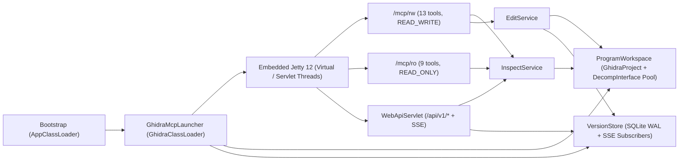

# ghidraMCP internals and architecture

`ghidraMCP` is a standalone headless Java application that embeds Ghidra 12.2, Jetty 12, SQLite, and the MCP Java SDK 2.1.0 inside one JVM. It runs without Swing, AWT windows, or `Xvfb`.

## Component architecture

| Class | Role |
|---|---|
| `Bootstrap` | Minimal entry point loaded on `AppClassLoader` alongside Ghidra `Utility.jar`. |
| `GhidraMcpLauncher` | Implements `GhidraLaunchable`; parses flags, boots Jetty and Ghidra, writes `ready.json`, and coordinates shutdown. |
| `ProgramWorkspace` | Owns the single `GhidraProject` and `Program`, SHA-256 project cache, `ReentrantReadWriteLock`, `DecompInterface` pool, and decompile cache. |
| `InspectService` | Implements the 9 read-only MCP queries and live inspection REST handlers under read lock. |
| `ProgramExporter` | Exports zero-duplication pseudocode (`src/`), `types.h`, `symbols.json`, `functions.jsonl`, `callgraph.jsonl`, and `manifest.json` to `<work-dir>/code/v<N>/` via `--dump` or `POST /api/v1/export`. |
| `EditService` | Enforces `AccessMode.READ_WRITE`, checks `expected_version`, runs single-transaction edits, computes diffs, and applies multi-step reverts under write lock. |
| `VersionStore` | SQLite WAL ledger storing `v0` metadata, ordered mutation versions, inverse operations, function diffs, checkpoints, and SSE event listeners. |
| `McpEndpoints` | Registers the read-only and read-write MCP transports with tool annotations. |
| `WebApiServlet` | Serves the `/api/v1/*` JSON inspection and history routes, the SSE event stream, export, and shutdown. |
| `ApiError` | Typed fault (`code`, `currentVersion`), `AccessMode` enum, request argument validation, cursor codec, and LCS unified diff generator. |

Each version's export is published in one atomic directory move. Repeat exports reuse the snapshot after checking the manifest and listed files. An incomplete snapshot produces a CLI error or HTTP `409` with code `INCOMPLETE_EXPORT`.

## REST and SSE API

`WebApiServlet` exposes read parity with the MCP inspection tools plus history, export, and lifecycle routes:

- `GET /api/v1/health`: liveness and phase (`analyzing`, `ready`, `error`, or `recovery_required`). Requires no bearer token.
- `GET /api/v1/status`: program metadata, MCP URLs, and uptime.
- `GET /api/v1/versions` and `GET /api/v1/versions/<v>`: version summaries and single-version details with operations and diffs.
- `GET /api/v1/diff`: cumulative range diff across `from`, `to`, and an optional `function` filter.
- `GET /api/v1/functions` and `GET /api/v1/functions/<target>`: paginated function list and single-function decompilation with `offset`, optional `disasm=true`, `disasm_cursor`, and `max_instructions`. Path decoding preserves literal `+` characters in function names.
- `GET /api/v1/symbols`, `GET /api/v1/xrefs`, `GET /api/v1/memory`, `GET /api/v1/search`, and `GET /api/v1/types`: read-only inspection routes matching the corresponding MCP tools.
- `GET /api/v1/events`: Server-Sent Events stream capped at 16 concurrent subscribers. Returns HTTP `503` with code `TOO_MANY_STREAMS` when full.
- `POST /api/v1/export` and `POST /api/v1/shutdown`: write-authenticated export and graceful shutdown.

Typed `ApiError` responses map `RECOVERY_REQUIRED` and `DECOMPILER_BUSY` to HTTP `503`, `INCOMPLETE_EXPORT` and `STALE_VERSION` to HTTP `409`, codes containing `NOT_FOUND` to HTTP `404`, and other errors to HTTP `400`.

## Classloader and headless boot

Ghidra 12.2 requires `-Djava.system.class.loader=ghidra.GhidraClassLoader`. Because `GhidraClassLoader` delegates parent-first to `AppClassLoader`, placing server classes on the JVM `-cp` makes them unable to resolve Ghidra module classes loaded later into `GhidraClassLoader`.

`build.gradle` splits the build into two artifacts:

1. `bootstrap.jar` contains only `Bootstrap`, which depends solely on JDK classes and `Utility.jar`.
2. `build/server/lib/*.jar` contains `ghidraMCP-0.2.0.jar`, Jetty, MCP SDK, Jackson, Gson, SLF4J 2, and `sqlite-jdbc`.

`Bootstrap.main` adds `lib/*.jar` to `GhidraClassLoader` first (so SLF4J 2.0.17 wins over Ghidra's bundled SLF4J 1.7.25), calls `GhidraLauncher.initializeGhidraEnvironment()` to append Ghidra's modules, and reflectively invokes `GhidraMcpLauncher.launch`.

`GhidraMcpLauncher` initializes Ghidra via `Application.initializeApplication(layout, new HeadlessGhidraApplicationConfiguration())`. `bin/log4j-headless.xml` routes `console`, `detail`, and `script` appenders to `SYSTEM_ERR` at level `WARN`, keeping `stdout` clean for the single ready JSON line.

## Startup, Jetty proxying, and shutdown

Jetty starts before Ghidra opens the binary. Two `ProxyServlet` placeholders on `/mcp/rw` and `/mcp/ro` return HTTP `503` while `WebApiServlet` serves `/api/v1/health` with `status: "analyzing"`. Once `ProgramWorkspace` and `VersionStore` finish initialization, `GhidraMcpLauncher` attaches the real MCP transports, marks the servlet `ready`, writes `ready.json` atomically via `.tmp` rename, and prints the ready JSON line to `stdout`.

On shutdown, `GhidraMcpLauncher` removes `ready.json`, interrupts the event workers, and closes Jetty, the MCP transports, SQLite, and the Ghidra project. Each successful edit is already saved. `POST /api/v1/shutdown` registers before Ghidra analysis starts, so it can stop the server while `/api/v1/health` still reports `analyzing`.

## Workspace concurrency, caching, and Ghidra internals

- **Project lifecycle and SHA-256 cache**: `ProgramWorkspace.open` checks `--work-dir/ghidra-project/workspace.gpr` first to resume an existing session. On a cold run, it hashes the input binary; if `<cache-dir>/<sha256>/workspace.gpr` exists, it copies that project (skipping `*.lock*` files) into `--work-dir`. Otherwise it imports the binary, runs `GhidraProject.analyze(program)`, persists via `project.saveAs(program, "/", binaryName, true)`, and populates the cache atomically via a temporary sibling directory.
- **Locking and decompiler pooling**: Read queries acquire `rwLock.readLock()` and borrow one `DecompInterface` from a bounded `ArrayBlockingQueue` (default size `2`), allowing concurrent read-only subagent calls. Mutations acquire `rwLock.writeLock()`, invalidate `decompileCache` (up to `512` immutable entries), and flush every `DecompInterface` cache.
- **Decompiler vs database variables**: `Function.getAllVariables()` omits variables synthesized only in decompiler output (`local_*`, `uVar*`, `param_*`). `ProgramWorkspace.extractVariables` merges `HighFunction.getLocalSymbolMap().getSymbols()` with DB variables. `EditService` resolves `HighSymbol` targets and commits renames, types, and variable comments back to the Ghidra database via `HighFunctionDBUtil.updateDBVariable(...)`, tracking intra-batch aliases so a later op in the same `apply_edits` array sees an earlier rename.
- **Data types and global safety**: `InspectService.getType` searches both `program.getDataTypeManager()` and `BuiltInDataTypeManager.getDataTypeManager()`. `EditService.defineType` parses C declarations inside an isolated `StandAloneDataTypeManager` first so invalid C cannot mutate the program. `parseType` accepts full category paths, unique short names (including pointers/arrays), and C primitives. Global type updates enforce non-executable memory with no instructions; larger replacements or overlays across adjacent globals require `allow_resize=true`, which captures every overwritten data unit (and its comments) for lossless multi-op `revert`. Dynamic data types such as `/string` also record their byte length so `revert` restores them cleanly. `set_signature` preserves variadic flags.
- `create_function` disassembles code when needed and creates a function. `EditService` uses Ghidra's managed transaction to roll back an edit if the error occurs before the project save begins.
- **Program metadata and memory reads**: `InspectService` filters `entry_points` to executable non-external functions, marks external-block thunks with `external: true` in function lists, and excludes them from pseudocode search and exports. Segment metadata includes `initialized`, `overlay`, and `external` flags. `read_memory` rejects uninitialized memory blocks and clamps reads to block bounds up to 4096 bytes.
- Pseudocode search uses a three-second decompiler budget per page. If the budget runs out, its cursor resumes at the next unprocessed function. If the budget expires before any function finishes, the server returns `DECOMPILER_BUSY`, which maps to HTTP `503` on `/api/v1/search`.
- Each event stream uses a worker and a bounded queue. A shutdown, disconnect, or full queue stops the worker. Idle connections send a heartbeat every five seconds. Edit requests only enqueue events.

## Version store and rollback

`VersionStore` persists a linear ledger in `--work-dir/history.sqlite` with WAL mode and `synchronous=FULL`.

- `meta` stores binary metadata and tracks the pending version and the first version recorded with the current type rules.
- `versions`: stores sequential `version` (`0` for `initial`), `parent_version`, `created_at`, `actor`, `operation`, `reason`, `checkpoint_label`, `ops_json`, `inverse_ops_json`, and `functions_json`.
- `function_diffs`: stores per-touched-function `before_c`, `after_c`, `diff_text`, and `decompile_status`.

Every edit checks `expected_version` before making changes. The server writes the candidate version and diffs to SQLite as pending. It saves the project with the same version number, then publishes the version in the ledger. Startup compares the pending version with the saved project and either publishes or discards the pending row. If the saved and recorded versions cannot be reconciled, startup fails. If a save or publication fails during an edit, inspection returns HTTP 503 and health reports `recovery_required` until restart.

Older projects have no saved version number. On first open, the server pairs the saved project with the current ledger version and starts tracking that pair. An inconsistency from a crash before the upgrade cannot be detected by the new marker.

`revert` checks the entire requested range before applying inverse operations and records a new version on success. `define_type` rejects overwrites. A revert that crosses a legacy type definition or a version with an operation the server cannot reverse returns `REVERT_UNAVAILABLE`. `save_checkpoint` labels the current saved version.

Range diffs compare pseudocode by function address. When a name filter matches a function, the diff includes its earlier edits in the range under other names. Address filters accept both zero-padded hex addresses and short `0x`-prefixed hex addresses.

## Transport and access control

- **Role isolation**: `McpEndpoints` mounts `/mcp/ro` with only the 9 read tool specifications (`readOnlyHint = true`) and `/mcp/rw` with all 13 tools (`apply_edits`, `define_type`, `revert`, `save_checkpoint` marked `readOnlyHint = false`). `EditService` also checks `AccessMode.READ_WRITE` at entry as defense in depth.
- A single HTTP filter checks the host, origin, and bearer token for both transports. It accepts loopback hosts, the configured bind host, and the host from `--public-url`. Browser requests may use the server's own origin, the `--public-url` origin, or the value of `--cors-origin`. `--cors-origin` accepts one explicit origin, `null`, or `loopback` for any HTTP or HTTPS origin on `127.0.0.1`, `localhost`, or `[::1]` with a valid port and no path, query, fragment, or userinfo. The server rejects `*`.
- When tokens are configured, either token authorizes inspection, including the REST and event routes. The write token authorizes mutations, `POST /api/v1/export`, and shutdown. The health endpoint can load without a token. The WebUI calls the REST and SSE endpoints over HTTP.
